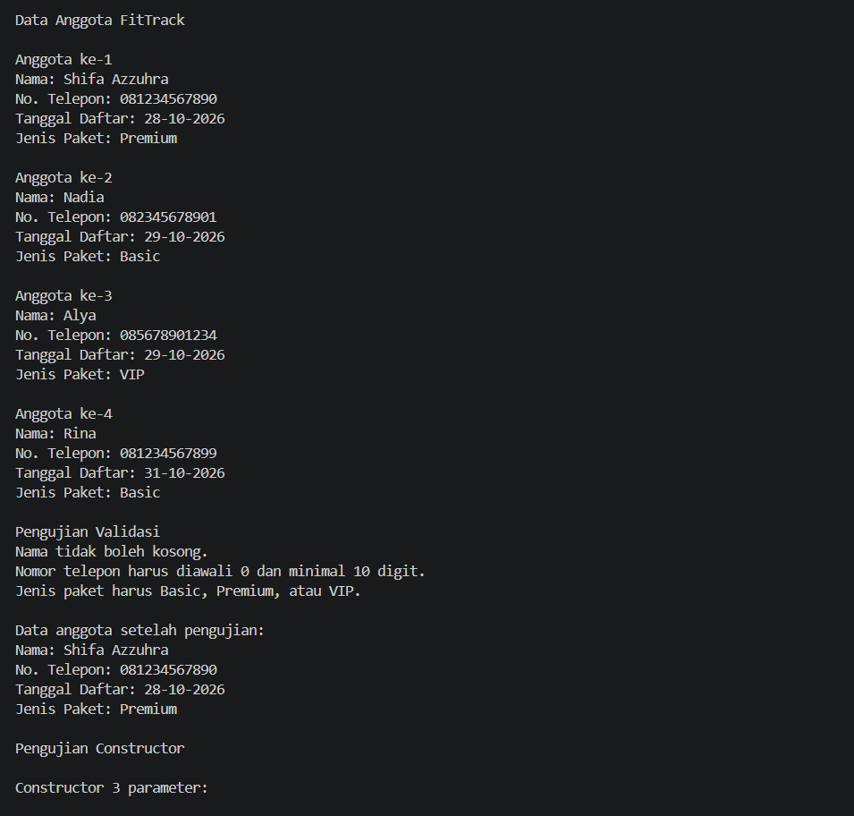
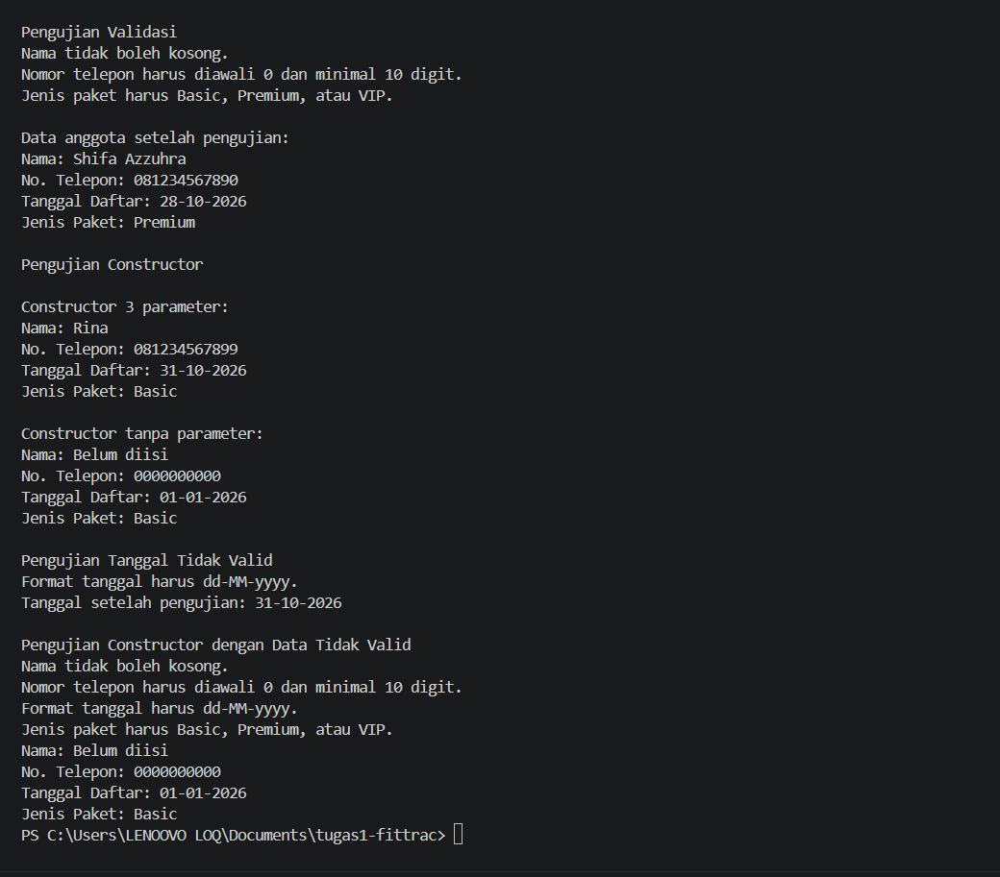

# FitTrack

**Tugas 1 – Remedial UTS Praktikum Pemrograman Berorientasi Objek**

**Nama:** Shifa Azzuhra  
**NPM:** 250810701100088  
**Kelas Praktikum:** A

## Deskripsi Program

FitTrack merupakan program sederhana berbasis Java untuk mengelola data keanggotaan gym. Program ini dibuat untuk membantu pencatatan informasi anggota agar lebih teratur dan mengurangi kesalahan penginputan data. Data anggota disimpan sementara selama program berjalan.

## Fitur Utama

- Menyimpan nama, nomor telepon, tanggal pendaftaran, dan jenis paket anggota.
- Menampilkan data beberapa anggota gym.
- Memeriksa data yang dimasukkan agar sesuai dengan ketentuan.
- Menolak data tidak valid dengan pesan penjelasan.
- Mempertahankan data sebelumnya apabila perubahan tidak valid.
- Memberikan nilai default ketika data tidak valid saat pembuatan anggota baru.

## Konsep PBO yang Diterapkan

| Konsep | Penerapan | Alasan |
|---|---|---|
| Class dan Object | `Member.java` dan `TesFitTrack.java` | Merepresentasikan anggota gym sebagai objek |
| Encapsulation | Atribut private, getter, dan setter | Mengatur akses dan perubahan data anggota |
| Constructor Overloading | Constructor pada class `Member` | Memungkinkan pembuatan objek dengan jumlah parameter berbeda |
| Method Overriding | Method `toString()` | Menampilkan informasi anggota dengan format yang mudah dibaca |
| Array dan Perulangan | Array `daftarMember` dan perulangan `for` | Menyimpan serta menampilkan beberapa anggota |

## Struktur Project

```text
tugas1-fittrack/
├── screenshots/
│   ├── output-anggota.png
│   └── output-validasi.png
├── src/
│   ├── Member.java
│   └── TesFitTrack.java
├── .gitignore
└── README.md
```

## Prasyarat

- Java Development Kit (JDK) 25
- Visual Studio Code dengan Java Extension Pack atau IntelliJ IDEA
- Terminal untuk menjalankan perintah Java

## Cara Menjalankan Program

### Menggunakan Terminal

Buka terminal pada folder utama project, kemudian jalankan:

```powershell
javac src/Member.java src/TesFitTrack.java
java -cp src TesFitTrack
```

### Menggunakan IntelliJ IDEA

1. Buka IntelliJ IDEA dan pilih Open.
2. Pilih folder project `tugas1-fittrack`.
3. Pastikan JDK sudah dikonfigurasi.
4. Buka file `TesFitTrack.java`.
5. Jalankan method `main()` melalui tombol Run.

## Contoh Output Program

Program menampilkan empat anggota dengan jenis paket Basic, Premium, dan VIP. Program juga menampilkan pengujian validasi, constructor, dan penggunaan nilai default.

**Output data anggota:**



**Output pengujian validasi:**



## Nilai Default

Jika constructor menerima data yang tidak valid, program menggunakan nilai default berikut:

| Atribut | Nilai Default |
|---|---|
| Nama | Belum diisi |
| Nomor telepon | 0000000000 |
| Tanggal daftar | 01-01-2026 |
| Jenis paket | Basic |

Nilai default digunakan agar objek tetap dapat dibuat meskipun terdapat kesalahan input. Nama `Belum diisi` menunjukkan bahwa nama anggota belum tersedia. Nomor telepon `0000000000` digunakan sebagai nilai sementara yang memenuhi aturan format, bukan sebagai nomor telepon aktif. Tanggal `01-01-2026` menjadi tanggal sementara dengan format yang konsisten, sedangkan `Basic` dipilih karena merupakan salah satu paket yang tersedia.

## Batasan dan Pengembangan Lanjutan

Program masih berbasis console dan belum memiliki antarmuka grafis maupun database. Data anggota hanya tersimpan selama program berjalan.

Validasi tanggal saat ini hanya memeriksa format `dd-MM-yyyy`, belum memeriksa apakah tanggal tersebut benar-benar ada di kalender.

Ke depannya, program dapat dikembangkan dengan fitur pencarian anggota, penyimpanan database, pengelolaan paket, dan tampilan yang lebih mudah digunakan.